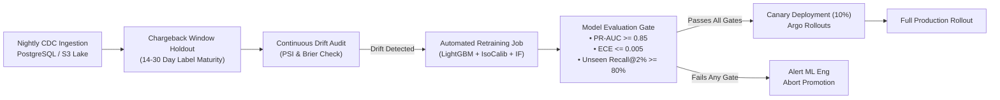

# 🚀 Production & Deployment Strategy: Feasibility, Scalability & MLOps

[](https://www.docker.com/)
[](https://kubernetes.io/)
[](https://redis.io/)
[](https://prometheus.io/)
[](https://www.terraform.io/)

---

## 1. Feasibility & Operational Viability Analysis

### A. Resource Sizing & Compute Requirements

The platform has been intentionally architected to eliminate bloated deep learning infrastructure in favor of high-throughput, cache-efficient compiled gradient-boosted trees and low-overhead density estimators.

```
+----------------------------------------------------------------------------------------------------+
|                               HARDWARE & COMPUTE PROFILES BY REGIME                                |
+----------------------+---------------------------+-------------------------------------------------+
| Environment Tier     | Minimum Hardware Sizing   | Performance Capacity & Throughput Targets       |
+----------------------+---------------------------+-------------------------------------------------+
| Local / Dev / MVP    | 2 vCPU, 4 GB RAM, 10 GB   | 150 – 300 TPS (Transactions Per Second)         |
| (Single Instance)    | SSD (Developer Laptop)    | P95 Latency: < 25ms (in-process feature engine) |
+----------------------+---------------------------+-------------------------------------------------+
| Staging / QA         | 4 vCPU, 8 GB RAM, 50 GB   | 1,200 – 1,800 TPS                               |
| (2 Pods + Redis)     | NVMe (t4g.xlarge / c6g)   | P95 Latency: < 18ms                             |
+----------------------+---------------------------+-------------------------------------------------+
| Enterprise Prod      | 16 vCPU, 32 GB RAM        | 10,000 – 25,000+ TPS (Horizontally scalable)    |
| (EKS/GKE Multi-Node) | Redis Cluster (3 Shards)  | P95 Latency: < 12ms (P99 < 28ms)                |
+----------------------+---------------------------+-------------------------------------------------+
```

### B. Enterprise Cost Modeling (AWS Infrastructure Example)

Estimated monthly operational expenditure for a medium-to-large fintech processing **50,000,000 transactions/month (~1,200 peak TPS)**:

| Infrastructure Component | AWS Service Spec | Units / Sizing | Monthly Cost (USD) |
| :--- | :--- | :--- | :--- |
| **API & Inference Workers** | Amazon EKS (Fargate / EC2 Spot + On-Demand) | 4x `c6g.xlarge` (ARM Graviton) | \$198.50 |
| **Distributed Feature Store** | Amazon ElastiCache for Redis (Cluster Mode) | 3-node `cache.m6g.large` | \$214.20 |
| **Event Streaming Ingestion** | Amazon Managed Streaming for Apache Kafka | 3-broker `kafka.m5.large` | \$328.00 |
| **Persistent Audit Store** | Amazon Aurora PostgreSQL (Serverless v2) | 2 – 8 ACUs (Auto-scaling) | \$185.00 |
| **Object Store & Cold Parquet** | Amazon S3 (Standard + Glacier Instant) | 2 TB historical ledgers | \$46.00 |
| **Monitoring & Telemetry** | Amazon Managed Prometheus & Grafana | Custom metrics ingestion | \$65.00 |
| **CloudWatch & Network Egress** | VPC Endpoints, NAT Gateway, Egress | Standard multi-AZ egress | \$110.00 |
| **Total Estimated Run-Rate** | — | — | **\$1,146.70 / month** |

*Cost Efficiency Benchmark:* Processing 50M transactions at **~\$0.000023 per transaction**, representing over **90% cost savings** compared to proprietary legacy fraud SaaS solutions that typically bill \$0.002 to \$0.01 per evaluation.

---

## 2. Scalability Blueprint & Distributed Architecture

### Distributed High-Throughput Production Topology

```mermaid
flowchart TD
    subgraph INGRESS["Global Edge & Ingress Layer"]
        CLIENTS["Payment Gateways / Core Banking / POS"]
        ALB["Cloud Load Balancer (AWS ALB / Cloudflare WAF)<br/>TLS Termination & Rate Limiting"]
        CLIENTS --> ALB
    end

    subgraph INGESTION_BUS["Decoupled Event Streaming Bus"]
        KAFKA["Apache Kafka / Redpanda Cluster<br/>Topic: `transactions.inbound`<br/>Partition Key: hash(customer_id)"]
        ALB -->|Async Mode / Webhook| KAFKA
    end

    subgraph API_NODES["Kubernetes Inference Pods (Stateless Autoscaling)"]
        POD1["Inference Worker Pod 1<br/>FastAPI + LightGBM C++"]
        POD2["Inference Worker Pod 2<br/>FastAPI + LightGBM C++"]
        PODN["Inference Worker Pod N<br/>FastAPI + LightGBM C++"]
        ALB -->|Sync Low-Latency Path| POD1
        ALB -->|Sync Low-Latency Path| POD2
        ALB -->|Sync Low-Latency Path| PODN
        KAFKA --> POD1
        KAFKA --> POD2
        KAFKA --> PODN
    end

    subgraph FEATURE_STORE["Distributed In-Memory Feature Store"]
        REDIS[("Redis 7.2 Cluster (DragonflyDB)<br/>• Customer Sliding Windows (Sorted Sets)<br/>• Atomic Lua Counter Scripts<br/>• Global & Segment Priors Cache")]
        POD1 <--> REDIS
        POD2 <--> REDIS
        PODN <--> REDIS
    end

    subgraph ASYNC_WORKERS["Asynchronous Explainability & Alert Queue"]
        CELERY["Celery / Redis Worker Pool<br/>(Background TreeSHAP Computation)"]
        ALERT_SVC["Alert Dispatch & Notification Service<br/>(Slack, Webhooks, Case Management)"]
        POD1 -.->|On Alert (1-2% traffic)| CELERY
        POD2 -.->|On Alert (1-2% traffic)| CELERY
        CELERY --> ALERT_SVC
    end

    subgraph STORAGE_LAYER["Persistent Analytical & Audit Lake"]
        POSTGRES[("PostgreSQL 16 Cluster<br/>Partitioned Alert Decisions & Audits")]
        ICEBERG[("Apache Iceberg / S3 Parquet Lake<br/>Historical Data for MLOps Retraining")]
        POD1 --> POSTGRES
        POD2 --> POSTGRES
        POSTGRES --> ICEBERG
    end
```

### A. Horizontal Scaling & Stateful Feature Extraction in Redis
The in-memory dictionary state from the prototype is transitioned to a distributed **Redis 7.2 Cluster**:
1. **Partitioning Key Strategy:** Kafka topics and Redis keys are partitioned strictly by `hash(customer_id)`. This guarantees that transactions for any single customer arrive in strict chronological sequence at the assigned consumer worker.
2. **Sliding-Window Velocity via Redis Sorted Sets (`ZSET`):**
   - Each transaction executes an atomic Lua script:
   ```lua
   -- Key: velocity:{customer_id}:5m
   -- ARGV[1]: current_timestamp, ARGV[2]: 300 (window_seconds), ARGV[3]: tx_id, ARGV[4]: amount
   local cutoff = tonumber(ARGV[1]) - tonumber(ARGV[2])
   redis.call('ZREMRANGEBYSCORE', KEYS[1], '-inf', cutoff)
   redis.call('ZADD', KEYS[1], ARGV[1], ARGV[3] .. ':' .. ARGV[4])
   local count = redis.call('ZCARD', KEYS[1])
   redis.call('EXPIRE', KEYS[1], tonumber(ARGV[2]) * 2)
   return count
   ```
   - Execution time: **< 0.4 milliseconds** per transaction.
3. **Decoupled Asynchronous Explainability:**
   - In production, computing TreeSHAP for every single clean transaction wastes compute.
   - For `normal` and `monitor` decisions (~98% of volume), the response is returned immediately in `< 10ms`.
   - For `review` and `high-risk` decisions (~2% of volume), full TreeSHAP explanations are computed either synchronously (if requested via `include_explanation=True`) or queued to a Celery/Redis background worker that hydrates the fraud analyst case queue.

---

## 3. Deployment Strategy: Docker & Cloud Infrastructure

### A. Multi-Stage Production Containerization (`Dockerfile`)

```dockerfile
# ==============================================================================
# Multi-Stage Dockerfile for Unseen-Customer Fraud Engine
# Stage 1: Build & Dependency Wheel Cache
# ==============================================================================
FROM python:3.11-slim-bullseye AS builder

WORKDIR /build
RUN apt-get update && apt-get install -y --no-install-recommends \
    build-essential \
    libgomp1 \
    && rm -rf /var/lib/apt/lists/*

COPY requirements.txt .
RUN pip install --user --no-cache-dir -r requirements.txt

# ==============================================================================
# Stage 2: Final Minimal Runtime Image
# ==============================================================================
FROM python:3.11-slim-bullseye AS runner

WORKDIR /app
RUN apt-get update && apt-get install -y --no-install-recommends \
    libgomp1 \
    curl \
    && rm -rf /var/lib/apt/lists/*

# Copy installed Python packages from builder
COPY --from=builder /root/.local /root/.local
ENV PATH=/root/.local/bin:$PATH

# Create non-root application user
RUN useradd -m -u 10001 frauduser
USER frauduser

# Copy codebase and trained models
COPY --chown=frauduser:frauduser src/ ./src/
COPY --chown=frauduser:frauduser api/ ./api/
COPY --chown=frauduser:frauduser models/ ./models/
COPY --chown=frauduser:frauduser config.yaml .

EXPOSE 8000
HEALTHCHECK --interval=15s --timeout=3s --retries=3 \
  CMD curl -f http://localhost:8000/health || exit 1

ENTRYPOINT ["uvicorn", "api.main:app", "--host", "0.0.0.0", "--port", "8000", "--workers", "4", "--access-log"]
```

### B. Microservice Orchestration via Docker Compose (`docker-compose.yml`)

```yaml
version: '3.8'

services:
  fraud-api:
    build:
      context: .
      dockerfile: Dockerfile
    image: fraud-engine:latest
    container_name: fraud-engine-api
    restart: always
    ports:
      - "8000:8000"
    environment:
      - REDIS_HOST=redis
      - REDIS_PORT=6379
      - LOG_LEVEL=INFO
    depends_on:
      redis:
        condition: service_healthy
    networks:
      - fraud-network

  fraud-dashboard:
    build:
      context: .
      dockerfile: Dockerfile.dashboard
    image: fraud-dashboard:latest
    container_name: fraud-engine-dashboard
    restart: always
    ports:
      - "8501:8501"
    environment:
      - API_URL=http://fraud-api:8000
    depends_on:
      - fraud-api
    networks:
      - fraud-network

  redis:
    image: redis:7.2-alpine
    container_name: fraud-engine-redis
    restart: always
    ports:
      - "6379:6379"
    command: redis-server --appendonly yes --maxmemory 2gb --maxmemory-policy allkeys-lru
    healthcheck:
      test: ["CMD", "redis-cli", "ping"]
      interval: 5s
      timeout: 3s
      retries: 5
    networks:
      - fraud-network

networks:
  fraud-network:
    driver: bridge
```

### C. Kubernetes Horizontal Pod Autoscaler (HPA) Manifest

```yaml
apiVersion: autoscaling/v2
kind: HorizontalPodAutoscaler
metadata:
  name: fraud-engine-hpa
  namespace: fraud-detection
spec:
  scaleTargetRef:
    apiVersion: apps/v1
    kind: Deployment
    name: fraud-engine-deployment
  minReplicas: 3
  maxReplicas: 25
  metrics:
  - type: Resource
    resource:
      name: cpu
      target:
        type: Utilization
        averageUtilization: 70
  - type: Pods
    pods:
      metric:
        name: http_requests_per_second
      target:
        type: AverageValue
        averageValue: 500m
  behavior:
    scaleUp:
      stabilizationWindowSeconds: 0
      policies:
      - type: Percent
        value: 100
        periodSeconds: 15
    scaleDown:
      stabilizationWindowSeconds: 300
      policies:
      - type: Percent
        value: 10
        periodSeconds: 60
```

---

## 4. Production Readiness Checklist: Monitoring, Telemetry & MLOps

```
+----------------------------------------------------------------------------------------------------+
|                                  MLOPS TELEMETRY & OBSERVABILITY                                   |
+--------------------------+------------------------------+------------------------------------------+
| Telemetry Vector         | Monitoring Technology        | Alert Threshold & SLA Objective          |
+--------------------------+------------------------------+------------------------------------------+
| API Latency (P95 / P99)  | Prometheus + Grafana         | P95 < 25ms, P99 < 50ms                   |
|                          | OpenTelemetry spans          | Alert if P95 > 40ms for 3 consecutive min|
+--------------------------+------------------------------+------------------------------------------+
| Alert Budget Depletion   | Custom Prometheus Counter    | Alert if hourly consumption > 85% of cap |
| (Hourly / Daily Caps)    | `fraud_alert_budget_ratio`   | within the first 20 minutes of hour      |
+--------------------------+------------------------------+------------------------------------------+
| Feature Drift            | Evidently AI / Prometheus    | Population Stability Index (PSI) > 0.15  |
| (Amount / Velocity dist) | Daily Kolmogorov-Smirnov     | triggers automated Slack ops warning     |
+--------------------------+------------------------------+------------------------------------------+
| Calibration Drift        | Brier score & ECE tracking   | Trigger retraining pipeline if ECE > 0.01|
| (True odds misalignment) | on delayed chargeback ground | on 14-day rolling chargeback cohort      |
+--------------------------+------------------------------+------------------------------------------+
| Cold-Start Ratio Spikes  | Ingestion monitoring         | Trigger alert if unseen customer ratio   |
|                          | `unseen_customer_rate`       | deviates by > 3 sigma from diurnal norm  |
+--------------------------+------------------------------+------------------------------------------+
```

### Automated Retraining & Continuous Delivery (CI/CD) Workflow



1. **GitHub Actions CI Pipeline:** Automatically triggers on pull requests:
   - Linting (`flake8`, `black`, `isort`).
   - Unit tests & 18-step QA verification suite (`python scripts/qa_suite.py`).
   - Strict leakage checks (confirms zero future lookahead and raw ID absence).
2. **Canary Model Rollouts:** New model weights and novelty quantile distributions are deployed to 10% of traffic via Argo Rollouts or AWS ALB weighted target groups, monitoring real-time calibration before 100% traffic promotion.
3. **Emergency Circuit Breaker:** In the event of catastrophic API failure or Redis partition, the API enters a stateless heuristic fallback mode: authorizing transactions below \$100 and routing high amounts to asynchronous review queues without blocking cardholder checkouts.
