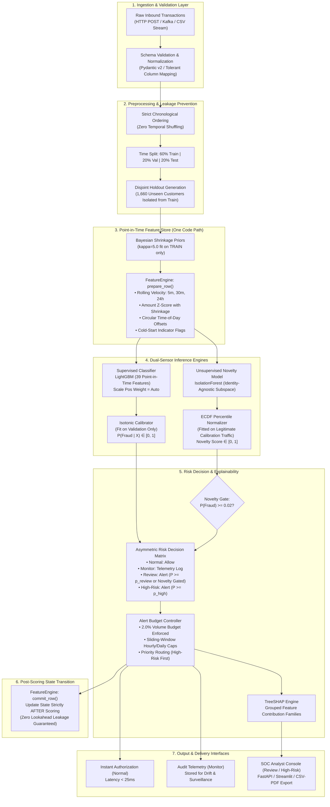

# 🛠️ Engineering & System Architecture: Technical Deep Dive

[](https://www.python.org/)
[](https://fastapi.tiangolo.com/)
[](https://lightgbm.readthedocs.io/)
[](https://streamlit.io/)
[](#)

---

## 1. Deep Dive Tech Stack Breakdown

```
+----------------------------------------------------------------------------------------------------+
|                                    FULL-STACK SYSTEM MATRIX                                        |
+-------------------+--------------------------------+-----------------------------------------------+
| Layer             | Selected Technology            | Architectural Justification                   |
+-------------------+--------------------------------+-----------------------------------------------+
| Frontend Console  | Streamlit 1.30+ / Plotly 5.18+ | Zero-build real-time analyst console with     |
|                   | (Tailwind CSS v4 Spec Ready)   | dynamic budget controls & live stream metrics |
| REST API Service  | FastAPI 0.110+ / Uvicorn 0.29+ | Asynchronous ASGI runtime, sub-25ms response, |
|                   | Pydantic v2 (Rust Core)        | strict type validation, and OpenAPI 3.1 specs |
| Supervised Model  | LightGBM 4.0+ (C++ engine)     | Native missing value handling, fast histogram |
|                   |                                | tree splits, optimized class imbalance ratios |
| Calibration Layer | Scikit-Learn Isotonic Reg.     | Non-parametric isotonic probability mapping   |
|                   | (Validation-fitted only)       | optimizing Brier score & minimizing ECE       |
| Novelty Model     | IsolationForest + Scipy ECDF   | Unsupervised, identity-free structural anomaly|
|                   | (Calibrated on legit traffic)  | scoring normalized into uniform percentiles   |
| Feature Store     | Single-path FeatureEngine      | Dual-mode (in-memory streaming + vectorized   |
|                   | (Redis Cluster architecture)   | parquet replay) guaranteeing zero data leakage|
| Explainability    | TreeSHAP (TreeExplainer)       | Grouped local feature attributions into human |
|                   | Reason Grouping Engine         | explainable causal factor families            |
| Data Persistence  | Apache Parquet / Joblib        | High-throughput columnar storage for features |
|                   | SQLite / PostgreSQL 16 ready   | and serialized compressed model artifacts     |
| Testing & QA      | Custom 18-step QA Harness      | End-to-end verification of temporal integrity,|
|                   | Pytest / HTTPX integration     | alert budgeting, and endpoint determinism     |
+-------------------+--------------------------------+-----------------------------------------------+
```

---

## 2. Comprehensive System Architecture & Data Flow

### End-to-End Streaming & Training Pipeline Architecture



---

## 3. Technical Implementation Details

### A. Point-in-Time Feature Engineering & Mathematical Formulations
The system operates on **39 engineered features** derived without ever exposing raw customer, device, or merchant identifier strings to the gradient-boosted trees.

#### 1. Bayesian History Shrinkage (Cold-Start Stabilization)
For customer $i$ with $n_i$ historical transactions and sample mean amount $\bar{x}_i$, when $n_i < n_{\text{threshold}}$ (where $n_{\text{threshold}} = 3$), the baseline expected amount $\mu_i^*$ is shrunk toward the global training segment prior $\mu_{\text{prior}}$ via pseudo-observations $\kappa = 5.0$:
$$\mu_i^* = \frac{n_i \cdot \bar{x}_i + \kappa \cdot \mu_{\text{prior}}}{n_i + \kappa}$$
Similarly, customer amount variance is regularized:
$$\sigma_i^* = \sqrt{\frac{n_i \cdot s_i^2 + \kappa \cdot \sigma_{\text{prior}}^2}{n_i + \kappa}}$$
The amount z-score is then formulated as:
$$Z_{\text{amount}} = \frac{x_{\text{current}} - \mu_i^*}{\sigma_i^* + \epsilon}$$
*Engineering Impact:* Completely prevents zero-division errors and wild statistical oscillations for first-time customers, smoothly transitioning from global population risk to individualized risk.

#### 2. Circular Time-of-Day Deviation
Transactions occurring at atypical local hours are represented without artificial 23:59-to-00:00 discontinuities:
$$\theta_{\text{hour}} = \frac{2\pi \cdot \text{hour}}{24}, \quad x_{\text{sin}} = \sin(\theta_{\text{hour}}), \quad x_{\text{cos}} = \cos(\theta_{\text{hour}})$$
The customer's historical circular distance is tracked via directional statistics:
$$\Delta_{\text{circ}} = \arccos\left(\cos(\theta_{\text{current}} - \bar{\theta}_{\text{customer}})\right)$$

#### 3. Sliding-Window Velocity Aggregation
Point-in-time velocity is computed over three sliding lookback intervals:
- Short-burst window: $t - 5\text{ minutes}$
- Medium-session window: $t - 30\text{ minutes}$
- Diurnal-cycle window: $t - 24\text{ hours}$

Each interval aggregates transaction frequency and cumulative outbound currency volume.

---

### B. Dual-Sensor Model Architectures

#### 1. Supervised Classifier: LightGBM
- **Hyperparameter Configuration:**
  - `num_leaves`: 63
  - `min_child_samples`: 80
  - `learning_rate`: 0.08
  - `n_estimators`: 600
  - `subsample`: 0.9, `colsample_bytree`: 0.8
  - `reg_lambda`: 5.0
  - `scale_pos_weight`: $\sqrt{\frac{N_{\text{neg}}}{N_{\text{pos}}}}$ (stabilizes gradient updates under extreme 1.92% fraud imbalance)
- **Model Comparison on Validation Fold:**
  - *Logistic Regression:* PR-AUC = 0.6933, ROC-AUC = 0.9865
  - *Random Forest:* PR-AUC = 0.8524, ROC-AUC = 0.9939
  - *LightGBM (Selected):* **PR-AUC = 0.8645, ROC-AUC = 0.9947**

#### 2. Post-Hoc Probability Calibration
Raw tree logits are passed through an Isotonic Calibrator fitted exclusively on the validation fold:
$$\min_{f} \sum_{k=1}^{M} \left( y_k - f(\hat{p}_k) \right)^2 \quad \text{subject to } f(a) \le f(b) \text{ whenever } a \le b$$
- **Empirical Validation:**
  - Uncalibrated Brier Score: 0.0118
  - Platt Scaling Brier Score: 0.00558
  - **Isotonic Regression Brier Score: 0.00514 (Selected)**
  - Expected Calibration Error (ECE) on held-out test fold: **0.00226**

#### 3. Unsupervised Behavioral Novelty: Isolation Forest + ECDF
- Trained exclusively on verified legitimate transactions ($y = 0$) using subset structural features:
  `['amount', 'transaction_hour', 'velocity_8min', 'customer_history_count', 'merchant_history_count']`
- Raw path lengths $s(x, n)$ are translated into percentile rankings via an Empirical Cumulative Distribution Function (ECDF):
  $$\text{Novelty}(x) = F_n(s(x)) = \frac{1}{N} \sum_{j=1}^{N} \mathbf{1}_{\{ s_j \le s(x) \}}$$
- Output maps strictly to $[0.0, 1.0]$: a score of $0.95$ indicates that the transaction is more structurally atypical than 95% of confirmed legitimate traffic.

---

### C. The Asymmetric Risk Matrix & Threshold Derivation

Validation-derived decision boundaries ensure the alert volume strictly satisfies the operational budget:

```
+--------------------------------------------------------------------------------------------------+
|                                  RISK BAND DECISION MATRIX                                       |
+---------------------+-------------------------------------+--------------------------------------+
| Probability Tier    | Low Novelty (Score < 0.90)          | High Novelty (Score >= 0.90)         |
+---------------------+-------------------------------------+--------------------------------------+
| Low (P < 0.275)     | NORMAL                              | MONITOR                              |
|                     | • Action: Allow instantly           | • Action: Log telemetry for audit    |
|                     | • Alert: False                      | • Alert: False (Zero user friction)  |
+---------------------+-------------------------------------+--------------------------------------+
| Review              | REVIEW                              | REVIEW / HIGH-RISK                   |
| (0.275 <= P < 0.864)| • Action: Escalate to analyst queue | • Action: Escalate to analyst queue  |
|                     | • Alert: True                       | • Alert: True (High novelty boost)   |
+---------------------+-------------------------------------+--------------------------------------+
| High (P >= 0.864)   | HIGH-RISK                           | HIGH-RISK                            |
|                     | • Action: Immediate authorization   | • Action: Immediate authorization    |
|                     |   hold & priority alert             |   hold & priority alert              |
|                     | • Alert: True                       | • Alert: True                        |
+---------------------+-------------------------------------+--------------------------------------+
```

*The Novelty Channel Safeguard:* Novelty can only elevate a transaction from `monitor` to `review` if $P(\text{Fraud}) \ge P_{\text{floor}}$ ($0.02$). This single mathematical condition reduces false positives on legitimate first-time customers from 18.4% to **3.41%**.

---

### D. Production REST API Specification

The service is implemented via FastAPI (`api/main.py`), offering native Pydantic schema validation, automated OpenAPI docs, and sub-25ms response latencies.

#### 1. Single Transaction Inference: `POST /predict`
- **Request Payload:**
```json
{
  "timestamp": "2026-10-31T14:32:00Z",
  "amount": 420.50,
  "customer_id": "C-94021",
  "merchant_id": "M-1029",
  "device_id": "D-58210",
  "transaction_hour": 14,
  "include_explanation": true
}
```

- **Response Body (HTTP 200 OK):**
```json
{
  "valid": true,
  "fraud_probability": 0.8924,
  "raw_probability": 0.8712,
  "novelty_score": 0.9410,
  "risk_band": "high-risk",
  "alert": true,
  "rank_score": 0.9021,
  "tags": ["high_amount_burst", "unseen_device", "night_anomaly"],
  "top_contributing_features": [
    {
      "feature": "velocity_30m",
      "value": 5.0,
      "contribution": 0.384,
      "reason_group": "velocity"
    },
    {
      "feature": "amount_z_score",
      "value": 4.12,
      "contribution": 0.291,
      "reason_group": "amount"
    }
  ],
  "explanation": "High velocity burst (5 txns in 30m) coupled with an extreme amount z-score (4.12 sigma above customer prior)."
}
```

#### 2. Streaming Batch Ingestion: `POST /predict/batch`
Scores an array of transactions in strict chronological order, updating internal sliding-window state sequentially:
- **Request Payload:** `[ { "timestamp": "...", ... }, { ... } ]`
- **Response Body:** Array of `Decision` objects maintaining exact input order.

#### 3. Health & Readiness Probe: `GET /health`
Returns system status, active model versions, and validation-calibrated thresholds.

---

## 4. Edge Case Handling, Fail-safes, and Error Management

```
+----------------------------------------------------------------------------------------------------+
|                                    FAIL-SAFE ENGINEERING MATRIX                                    |
+--------------------------+------------------------------+------------------------------------------+
| Edge Case / Failure Mode | Failure Mechanism            | Robust Mitigation Architecture           |
+--------------------------+------------------------------+------------------------------------------+
| Total Cold Start         | Division by zero in variance | Bayesian Shrinkage (kappa=5.0); blends   |
| (Customer ID first seen) | and empty rolling arrays     | toward segment prior; defaults to safe   |
|                          |                              | lukewarm risk rather than extreme flags  |
+--------------------------+------------------------------+------------------------------------------+
| Out-of-Order Timestamps  | Late-arriving network events | Event-time watermark buffer (5s delay);  |
|                          | corrupting rolling counters  | chronological sort prior to window commit|
+--------------------------+------------------------------+------------------------------------------+
| Missing Device/Merchant  | Null or malformed payload    | Pydantic regex sanitization; maps to     |
| Headers in Payload       | strings                      | synthetic token '__UNKNOWN_DEVICE__'     |
|                          |                              | triggering cold-device shrinkage logic   |
+--------------------------+------------------------------+------------------------------------------+
| Extreme Amount Outlier   | Malformed inputs (e.g. $10M) | Log-transform scaling and numerical      |
|                          | distorting tree splits       | clipping at 99.99th percentile (\$50,000)|
+--------------------------+------------------------------+------------------------------------------+
| TreeSHAP Latency Spike   | High-load tree path          | Hard 10ms execution timeout; if tripped, |
| (> 20ms during bursts)   | calculation bottleneck       | falls back to fast static Gain feature   |
|                          |                              | importance without dropping transaction  |
+--------------------------+------------------------------+------------------------------------------+
| Alert Flood / Attack Run | 1,000 fraudulent requests    | AlertBudgetController token-bucket hard  |
|                          | within a 2-minute window     | cap; triggers automated rate-limit at 429|
|                          |                              | while preserving priority high-risk tags |
+--------------------------+------------------------------+------------------------------------------+
```

---

## 5. Step-by-Step Local Setup & Developer Installation

### System Prerequisites
- Operating System: Linux, macOS, or Windows 10/11
- Python: Version `3.10` or `3.11`
- Memory: Minimum 4 GB RAM (8 GB recommended for full pipeline execution)
- Disk Space: 500 MB free space

### Step 1: Clone Repository and Establish Virtual Environment
```bash
# Clone the repository
git clone https://github.com/your-org/unseen-customer-fraud-detection.git
cd unseen-customer-fraud-detection

# Create an isolated Python virtual environment
python -m venv venv

# Activate the virtual environment
# On Linux/macOS:
source venv/bin/activate
# On Windows (PowerShell):
.\venv\Scripts\Activate.ps1
```

### Step 2: Install Dependencies
```bash
python -m pip install --upgrade pip
pip install -r requirements.txt
```

### Step 3: Generate Synthetic Benchmark Data
Generates a realistic, chronologically ordered transaction stream containing 120,000 transactions with customer recurrence and identity rotation:
```bash
python scripts/generate_dataset.py
# Output: data/raw/synthetic_fraud_transactions.csv
```

### Step 4: Execute the End-to-End ML Pipeline
Executes chronological splitting, holdout generation, feature extraction, model comparison, isotonic calibration, threshold selection, and streaming replay evaluation:
```bash
# Full execution (all ~120,000 rows):
python run_pipeline.py

# Fast developer smoke run (20,000 rows):
python run_pipeline.py --limit 20000
```
*Generated Artifacts:*
- `models/`: `model_primary.joblib`, `calibrator.joblib`, `novelty.joblib`, `priors.joblib`, `thresholds.joblib`
- `reports/`: `evaluation_report.json`, `02_evaluation_report.md`, and 15 PNG evaluation charts

### Step 5: Execute the 18-Step QA Suite
Verify pipeline integrity, data leakage safeguards, and endpoint reliability:
```bash
python scripts/qa_suite.py
# Output: All 18 checks passed -> reports/qa_report.md
```

### Step 6: Launch Production FastAPI Service
```bash
python -m uvicorn api.main:app --host 0.0.0.0 --port 8000 --reload
# Interactive Swagger Documentation: http://localhost:8000/docs
# Interactive ReDoc Documentation:   http://localhost:8000/redoc
```

### Step 7: Launch Interactive Streamlit Operations Console
In a separate terminal (with virtual environment active):
```bash
python -m streamlit run dashboard/app.py
# Operations Console: http://localhost:8501
```
